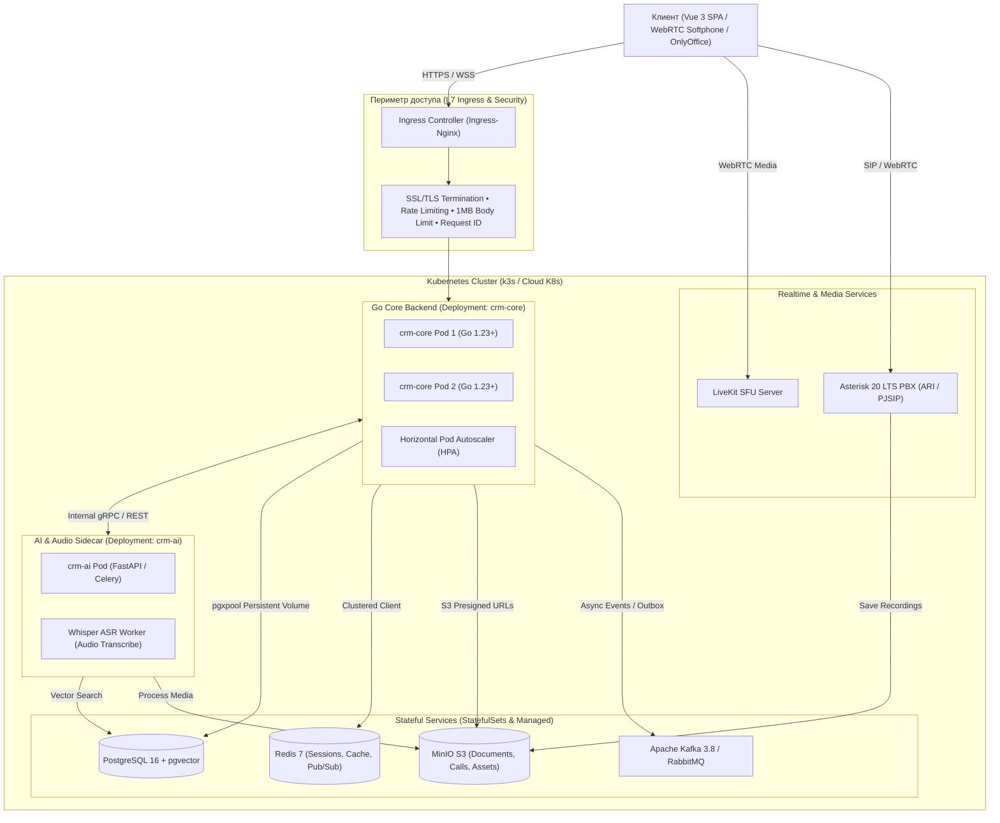
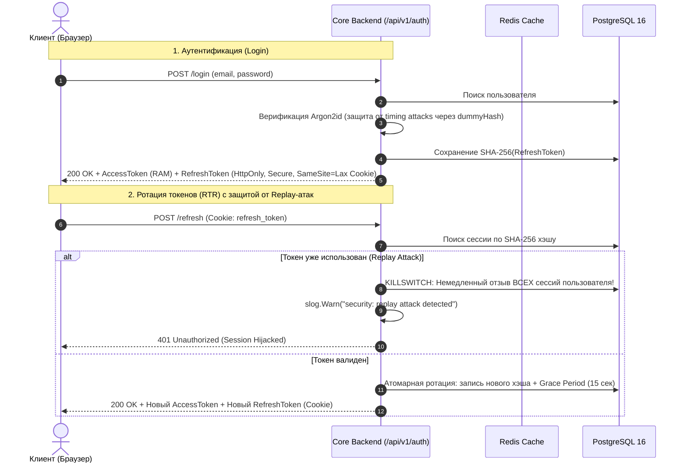

<div align="center">

# CRM AI: Enterprise All-in-One Cloud-Native Workspace

> **High-Performance Multi-Tenant SaaS Platform**: Dynamic No-Code Database, Kanban Workflows, Realtime Communications, Telephony, OnlyOffice Collaborative Suite, and Autonomous RAG AI Engine.

[](https://go.dev/)
[](https://kubernetes.io/)
[](https://vuejs.org/)
[](https://www.typescriptlang.org/)
[](https://www.postgresql.org/)
[](https://redis.io/)
[](https://kafka.apache.org/)
[](https://min.io/)
[](https://www.docker.com/)
[](#-security-first--zero-trust-архитектура)

</div>

---

## Содержание

- [CRM AI: Enterprise All-in-One Cloud-Native Workspace](#crm-ai-enterprise-all-in-one-cloud-native-workspace)
  - [Содержание](#содержание)
  - [Обзор платформы](#обзор-платформы)
  - [Архитектура системы и Kubernetes топология](#архитектура-системы-и-kubernetes-топология)
  - [Ключевые функциональные подсистемы](#ключевые-функциональные-подсистемы)
  - [Технологический стек](#технологический-стек)
    - [Core Backend (Go 1.23+)](#core-backend-go-123)
    - [Cloud-Native \& Kubernetes Infrastructure](#cloud-native--kubernetes-infrastructure)
    - [AI \& Media Sidecar (Python 3.12+)](#ai--media-sidecar-python-312)
    - [Frontend (Vue 3 + TypeScript)](#frontend-vue-3--typescript)
  - [Security-First \& Zero-Trust Архитектура](#security-first--zero-trust-архитектура)
    - [Ключевые инварианты защиты:](#ключевые-инварианты-защиты)
  - [Единый стандарт API (Envelope)](#единый-стандарт-api-envelope)
    - [Успешный ответ (`200 OK` / `201 Created`):](#успешный-ответ-200-ok--201-created)
    - [Ответ с ошибкой (`4xx` / `5xx`):](#ответ-с-ошибкой-4xx--5xx)
  - [Структура репозитория](#структура-репозитория)
  - [Развертывание и эксплуатация](#развертывание-и-эксплуатация)
    - [1. Локальная разработка (Docker Compose)](#1-локальная-разработка-docker-compose)
      - [Предварительные требования:](#предварительные-требования)
      - [Шаги запуска:](#шаги-запуска)
    - [2. Развертывание в Kubernetes (k3s / Cloud K8s)](#2-развертывание-в-kubernetes-k3s--cloud-k8s)
  - [Отказоустойчивость и Observability](#отказоустойчивость-и-observability)

---

## Обзор платформы

**CRM AI** — масштабируемая B2B SaaS-платформа корпоративного уровня, объединяющая полный спектр инструментов современного цифрового офиса в едином сверхбыстром рабочем пространстве:

- **Динамические No-Code таблицы** (аналог Airtable / Notion DB) с произвольной схемой данных, реляционными связями, формулами и оптимистическими блокировками.
- **Таск-трекер и гибкий Канбан** с контролем лимитов незавершенного производства (WIP limits), чек-листами и дедлайнами.
- **Корпоративный Realtime-мессенджер** с гарантированным порядком сообщений (`seq_no`), тредами, реакциями и отказоустойчивым паттерном *Transactional Outbox*.
- **Телефония и видеоконференции** (WebRTC SFU через LiveKit + IP-АТС на базе Asterisk 20+ LTS с интеграцией голосовых AI-ассистентов).
- **Совместный облачный офис** с интеграцией OnlyOffice Document Server (Word, Excel, PowerPoint) и S3-хранилищем.
- **Интеллектуальный RAG AI-контур** с семантическим векторным поиском (`pgvector`) по регламентам и сквозным контекстным анализом данных CRM.

---

## Архитектура системы и Kubernetes топология

Платформа спроектирована как **Cloud-Native Modular Monolith** с микросервисными AI-сайдкарами. Основное высоконагруженное ядро реализовано на **Go**, что гарантирует ультранизкие задержки (low latency), минимальный memory footprint и предсказуемую горизонтальную масштабируемость в Kubernetes.



---

## Ключевые функциональные подсистемы

| Подсистема | Описание возможностей | Технологический стек / Механика |
|---|---|---|
| **Identity & Access (IAM)** | Мультитенантность, контекст организаций, Argon2id, RTR ротация токенов, Killswitch | Go 1.23+, Argon2id, JWT в RAM, HttpOnly Cookie, Redis |
| **No-Code Tables** | Динамическая схема полей, формулы, реляционные связи, полнотекстовые фильтры | PostgreSQL JSONB, GIN-индексы, Optimistic Locking (`version`) |
| **Task Tracker & Kanban** | Доски, статусы, WIP-лимиты, чек-листы, назначение ответственных, календарные сетки | Go, PostgreSQL, Drag & Drop, TanStack Virtual |
| **Realtime Messenger** | Личные и групповые каналы, треды, реакции, Transactional Outbox, догон истории | WebSockets, Redis Pub/Sub, Kafka, Transactional Outbox |
| **Telephony & RTC** | Браузерный софтфон, SIP-транки, аудио/видео конференции, запись разговоров в S3 | Asterisk 20+ (ARI/PJSIP), LiveKit SFU, MinIO S3, WebRTC 1:1 |
| **Collaborative Docs** | Дерево папок, версионирование, многопользовательское редактирование DOCX/XLSX | OnlyOffice Document Server, S3 Presigned URLs, JWT Callback |
| **RAG Knowledge Base** | Векторизация базы знаний, семантический поиск, интеллектуальные ответы | PostgreSQL 16 `pgvector`, HNSW косинусный индекс, LLM API |
| **AI Assistant & ASR** | Автоматический саммари звонков, транскрибация речи, потоковая генерация | Python 3.12+ (FastAPI), Whisper ASR, Streaming SSE |
| **BI & Analytics** | Конструктор отчетов, визуальные графики, аналитические срезы по таблицам | Chart.js / ECharts, PostgreSQL Analytical Views |
| **Superadmin & Billing** | Изолированный контур управления тенантами, аудит, тарифные сетки, биллинг | ЮKassa / Stripe, изолированный Superadmin Realm |

---

## Технологический стек

### Core Backend (Go 1.23+)
- **Архитектура**: Clean Architecture & Standard Go Project Layout (`cmd/`, `internal/app/`, `internal/modules/`, `internal/infra/`).
- **Сетевой слой**: Высокопроизводительный роутинг, централизованные Middleware (Correlation ID, Rate Limiter, Panic Recovery, MaxBytesReader).
- **СУБД и драйвер**: `jackc/pgx/v5` с пулом соединений `pgxpool`, поддержка транзакций с автоматическим rollback.
- **Кэш и транзиентное состояние**: `redis/go-redis/v9`.
- **Криптография**: `golang.org/x/crypto/argon2` (RFC 9106), `crypto/rand` с аппаратной энтропией CSPRNG.

### Cloud-Native & Kubernetes Infrastructure
- **Оркестрация**: **Kubernetes (k3s / Cloud K8s)**, декларативное управление через Kustomize / Helm.
- **Жизненный цикл подов**:
  - `startupProbe`, `livenessProbe` и `readinessProbe` для каждого микросервиса.
  - **Graceful Shutdown**: обработка `SIGTERM`, перехват `<-ctx.Done()`, LIFO-закрытие пулов (HTTP -> Redis -> Postgres) и хуки `preStop: exec: sleep 5` для исключения 502/504 при ротации подов.
- **Сетевой периметр**: Ingress-Nginx с TLS-терминацией, Cert-Manager для автоматических сертификатов, CNI Flannel / Calico.
- **Хранилище данных**: PersistentVolumeClaims (PVC) с динамическим провижинингом через StorageClass (`local-path` / CSI).
- **Автомасштабирование**: `HorizontalPodAutoscaler` (HPA) на базе метрик CPU/RAM и Prometheus Adapter.

### AI & Media Sidecar (Python 3.12+)
- **Фреймворк**: FastAPI (AsyncIO), валидация контрактов Pydantic v2.
- **Векторный поиск**: SQLAlchemy 2.0 Async, `pgvector-python`.
- **Очереди задач**: Celery 5.4 + RabbitMQ / Apache Kafka 3.8.
- **Голосовая аналитика**: Локальный или распределенный инференс Whisper ASR для расшифровки звонков.

### Frontend (Vue 3 + TypeScript)
- **Стек**: Vue 3 (Composition API, `<script setup lang="ts">`), TypeScript 5.6+, Vite 5.
- **Клиентский стейт**: Pinia (изоляция чувствительных токенов строго в RAM).
- **Сетевой транспорт**: TanStack Vue Query v5 + Axios с интерцептором синхронизации через **Web Locks API** (защита от гонок при рефреше в нескольких вкладках).
- **UI & Дизайн-система**: Tailwind CSS v4, доступные Headless-примитивы Radix Vue (Reka UI), Storybook 8.

---

## Security-First & Zero-Trust Архитектура

> [!SECURITY]
> Архитектура безопасности построена по принципу абсолютного недоверия к входящему трафику. Данные тенантов строго изолированы, а учетные данные никогда не хранятся в открытом виде.



### Ключевые инварианты защиты:
1. **Изоляция тенантов (Anti-IDOR)**:
   - Все SQL-запросы к доменным сущностям принудительно включают условие `WHERE organization_id = $1`.
   - Операция смены активного контекста тенанта (`POST /switch-org`) проверяет валидность членства в таблице `organization_members`.
2. **Гигиена сессионных токенов**:
   - `Access Token` хранится **строго в оперативной памяти (RAM)**. Запрещено использование `localStorage` и `sessionStorage`.
   - `Refresh Token` передается исключительно через заголовок `Set-Cookie: HttpOnly; Secure; SameSite=Lax`.
   - В PostgreSQL сохраняются **только SHA-256 хэши** токенов. Даже полный дамп базы данных не раскрывает действующие сессии.
3. **Replay Attack Killswitch & Grace Period**:
   - Окно Grace Period (15 секунд) допускает параллельные запросы обновления токенов от открытых вкладок одного браузера.
   - Повторное предъявление старого токена вне окна Grace Period активирует защитный механизм **Killswitch**: все сессии скомпрометированного пользователя во всей системе мгновенно аннулируются.
4. **Защита периметра**:
   - Ограничение размера входящего тела запроса (`http.MaxBytesReader`) до **1 МБ**.
   - Redis Sliding-Window Rate Limiter предотвращает атаки перебора паролей и исчерпания ресурсов.

---

## Единый стандарт API (Envelope)

Все REST-эндпоинты платформы возвращают ответы в стандартизированной оболочке.

### Успешный ответ (`200 OK` / `201 Created`):
```json
{
  "ok": true,
  "data": {
    "user": {
      "id": "a5482390-349c-4f81-a67b-f9dcf3794380",
      "email": "lead@crm-ai.internal",
      "first_name": "Alexander",
      "last_name": "Orlov"
    },
    "current_organization_id": "0192d6e3-827c-7195-a249-16631ad02e48"
  },
  "error": null
}
```

### Ответ с ошибкой (`4xx` / `5xx`):
```json
{
  "ok": false,
  "data": null,
  "error": {
    "code": "ORGANIZATION_FORBIDDEN",
    "message": "User is not an active member of this organization",
    "details": {
      "target_organization_id": "0192d6e3-827c-7195-a249-16631ad02e48"
    }
  }
}
```

---

## Структура репозитория

```text
crm-ai/
├── contracts/                   # Спецификации контрактов и коллекции интеграционных тестов
│   ├── openapi/                 # OpenAPI 3.1 спецификации
│   └── http/auth.http           # Исполняемые REST-тесты сценариев безопасности
├── deploy/                      # Манифесты развертывания
│   ├── k8s/                     # Kubernetes манифесты (Deployments, Services, Ingress, HPA)
│   └── helm/                    # Helm-чарты для сервисов платформы
├── backend-go/                  # Высокопроизводительное ядро системы (Go 1.23+)
│   ├── cmd/server/              # Точка входа в приложение (main.go, graceful shutdown)
│   ├── internal/
│   │   ├── app/                 # DI-контейнер, инициализация зависимостей и lifecycle
│   │   ├── config/              # Строгая конфигурация из переменных окружения
│   │   ├── domain/              # Доменные сущности, ошибки и интерфейсы
│   │   ├── infra/               # Адаптеры БД, кэша, криптографии, роутинга и метрик
│   │   └── modules/             # Доменные контексты (Modular Monolith)
│   │       ├── auth/            # Аутентификация, сессии и мультитенантность
│   │       └── health/          # Kubernetes Readiness & Liveness пробы
│   └── migrations/              # SQL-миграции схемы данных
├── backend-python/              # Сервис AI/ML и фоновых задач (FastAPI, Python 3.12+)
│   ├── src/                     # RAG пайплайны, интеграция с Whisper ASR
│   └── pyproject.toml           # Управление зависимостями через uv
├── frontend/                    # Клиентское SPA-приложение (Vue 3, TypeScript, Vite)
│   ├── src/
│   │   ├── components/ui/       # Дизайн-система компонентов (Button, Modal, DataGrid)
│   │   └── stores/              # Pinia хранилища (Auth, Organization, Session)
│   └── .storybook/              # Конфигурация и изолированная разработка компонентов
├── docker-compose.yml           # Инфраструктурный стек для локальной разработки
└── Taskfile.yml                 # Автоматизация типовых консольных команд
```

---

## Развертывание и эксплуатация

### 1. Локальная разработка (Docker Compose)

#### Предварительные требования:
- **Docker Engine 24+** & **Docker Compose v2**
- **Go 1.23+**
- **Node.js 20+** & **npm**
- Утилита [Task](https://taskfile.dev/) *(опционально)*

#### Шаги запуска:
```bash
# 1. Клонирование и подготовка окружения
git clone https://github.com/adexcell/crm-ai-python.git
cd crm-ai-python
cp .env.example .env

# 2. Запуск контейнеров инфраструктуры
task up
# или напрямую: docker compose up -d

# 3. Запуск ядра на Go
cd backend-go
go mod download
go run cmd/server/main.go

# 4. Запуск UI приложения (в отдельном терминале)
cd frontend
npm install
npm run dev
```

Локальные интерфейсы управления:
- **Core Backend API**: `http://localhost:8000`
- **Frontend SPA**: `http://localhost:5173`
- **Storybook**: `http://localhost:6006`
- **PostgreSQL 16**: `localhost:5432`
- **Redis 7**: `localhost:6379`
- **RabbitMQ Dashboard**: `http://localhost:15672`
- **MinIO S3 Console**: `http://localhost:9001`
- **Kafka UI**: `http://localhost:8080`

---

### 2. Развертывание в Kubernetes (k3s / Cloud K8s)

При развертывании в кластере Kubernetes сервисы платформы изолируются по неймспейсам с контролем ресурсов и сетевыми политиками.

```bash
# 1. Создание изолированного пространства имен
kubectl create namespace crm-ai

# 2. Применение секретов и конфигурационных карт
kubectl apply -k deploy/k8s/overlays/production/

# 3. Контроль статуса запуска подов и прохождения Readiness Probes
kubectl get pods -n crm-ai -w
```

Пример базового манифеста сервиса с защитными пробами и Graceful Shutdown:
```yaml
apiVersion: apps/v1
kind: Deployment
metadata:
  name: crm-core-backend
  namespace: crm-ai
spec:
  replicas: 3
  strategy:
    type: RollingUpdate
    rollingUpdate:
      maxSurge: 1
      maxUnavailable: 0
  selector:
    matchLabels:
      app: crm-core
  template:
    metadata:
      labels:
        app: crm-core
    spec:
      terminationGracePeriodSeconds: 30
      containers:
        - name: core
          image: ghcr.io/adexcell/crm-ai-core:latest
          lifecycle:
            preStop:
              exec:
                command: ["/bin/sleep", "5"]
          ports:
            - containerPort: 8000
          resources:
            requests:
              cpu: "250m"
              memory: "256Mi"
            limits:
              cpu: "1000m"
              memory: "512Mi"
          startupProbe:
            httpGet:
              path: /api/v1/health/startup
              port: 8000
            failureThreshold: 10
            periodSeconds: 3
          readinessProbe:
            httpGet:
              path: /api/v1/health/ready
              port: 8000
            periodSeconds: 5
          livenessProbe:
            httpGet:
              path: /api/v1/health/live
              port: 8000
            periodSeconds: 10
```

---

## Отказоустойчивость и Observability

- **Метрики производительности**: Экспорт Prometheus метрик через эндпоинт `/metrics` (время ответа, процентили p50/p95/p99, RPS, ошибки 5xx, утилизация пула `pgxpool`).
- **Сквозная трассировка (Distributed Tracing)**: OpenTelemetry контекст пробрасывается через все уровни приложения.
- **Структурированное логирование**:
  - `log/slog` с сериализацией в JSON.
  - Атрибуты `request_id`, `organization_id`, `user_id` во всех логах запроса.
  - Ошибки уровня `slog.Error` фиксируют исключительно необработанные сбои (5xx), а `slog.Warn` используется для детекции инцидентов безопасности.
- **Нулевой простой (Zero-Downtime Rollout)**: За счет взаимной работы `readinessProbe`, `terminationGracePeriodSeconds` и пре-стоп хуков обновление сервисов происходит без потери активных сетевых соединений.

---

<div align="center">

**CRM AI** • Enterprise Cloud-Native Engineering

</div>
