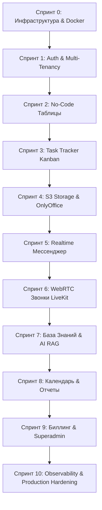

# Техническое Задание (ТЗ): Разработка CRM AI с нуля
## Полнофункциональная мультитенантная SaaS-платформа нового поколения

> **Назначение документа**: Детальное практическое руководство и спецификация для самостоятельной разработки архитектурно сложной платформы (All-in-One CRM Workspace) с нуля с целью глубокого изучения современных enterprise-технологий.

---

## 1. Концепция и цели проекта

### 1.1 Что представляет собой проект
**CRM AI** — это масштабируемая B2B SaaS-платформа, объединяющая в едином рабочем пространстве функционал:
1. **Dynamic Tables / No-Code DB** (аналог Airtable / Notion DB с формулами, связями и представлениями).
2. **Task Tracker / Kanban** (управление проектами, задачами, спринтами и чек-листами).
3. **Корпоративный Мессенджер & Realtime Chat** (личные/групповые чаты, каналы, rich-сообщения, реакции, треды).
4. **WebRTC Видео- и Аудиоконференции** (на базе LiveKit с записью звонков в S3 через Egress).
5. **Облачное хранилище документов & Совместный редактор** (интеграция с OnlyOffice для Word/Excel/PowerPoint).
6. **База знаний с семантическим поиском (RAG)** (pgvector, эмбеддинги, векторный поиск).
7. **Интеллектуальный AI-ассистент** (анализ контекста CRM, потоковая генерация, RAG-ответы, квоты и токены).
8. **Календарь и планировщик событий** (с фоновой рассылкой напоминаний через Celery Beat).
9. **BI-аналитика и конструктор дашбордов** (кастомные виджеты, графики, агрегации по таблицам).
10. **Биллинг и монетизация** (тарифные планы, пакеты токенов, автоплатежи через ЮKassa).
11. **Superadmin-контур** (глобальный аудит, управление тенантами, runtime-настройка AI и биллинга).

### 1.2 Цели обучения при разработке с нуля
В процессе реализации вы освоите на практике:
- Архитектуру **модульного монолита (Modular Monolith)** с изоляцией контекстов (Domain-Driven Design).
- Асинхронный бэкенд на **Python 3.12+ (FastAPI, asyncio, SQLAlchemy 2.0 Async, Pydantic v2)**.
- Работу с СУБД **PostgreSQL 16**: сложные транзакции, оптимистические блокировки, JSONB для динамических структур, расширение **pgvector** для векторных эмбеддингов.
- Очереди сообщений и распределенные фоновые задачи: **RabbitMQ + Celery + Redis** (worker + beat).
- S3-совместимое объектное хранилище **MinIO**: генерация Presigned URL для прямой безопасной загрузки файлов без нагрузки на API-сервер.
- Realtime-коммуникации: **WebSockets** (двунаправленный обмен, heartbeat, presence) + **Redis Pub/Sub** для горизонтального масштабирования.
- Медиастриминг и WebRTC: **LiveKit SFU Server**, выпуск JWT-токенов доступа, обработка webhook-событий, запись потоков (Egress).
- Офисную совместную работу: протокол интеграции **OnlyOffice Document Server** (JWT-подпись, lifecycle сохранения, callback API).
- Современный фронтенд: **React 18/19, TypeScript, Vite, Tailwind CSS, Radix UI, TanStack Query v5, TanStack Virtual, Zustand, Recharts, Monaco Editor**.
- Enterprise-безопасность: раздельные контуры аутентификации через **HttpOnly Secure Cookies**, CSRF, Correlation ID, Rate Limiting (SlowAPI), RBAC + ABAC.
- Observability & DevOps: контейнеризация через **Docker Compose**, реверс-прокси **Nginx**, мониторинг **Prometheus + Grafana**, логирование через **Structlog**, CI/CD пайплайны.

---

## 2. Технологический стек и инфраструктура

| Категория | Технологии | Зачем используется |
|---|---|---|
| **Язык бэкенда** | Python 3.12+ | Современный typing, async/await, высокая производительность |
| **API Framework** | FastAPI (uvicorn) | Высокопроизводительный асинхронный REST + WebSocket API, автодокументация OpenAPI/Swagger |
| **ORM & Миграции** | SQLAlchemy 2.0 (AsyncIO) + Alembic | Асинхронная работа с реляционной БД, строгая типизация запросов, миграции схемы |
| **База данных** | PostgreSQL 16 + pgvector | Надежная ACID-СУБД, хранение JSONB для no-code полей, векторный поиск для RAG |
| **Кэш и Pub/Sub** | Redis 7 | Кэширование, хранение пользовательских сессий, rate limiting, pub/sub для WS-брокера |
| **Брокер очередей** | RabbitMQ 3.13 | Гарантированная доставка сообщений для тяжелых фоновых задач |
| **Фоновые задачи** | Celery 5.4 (Worker + Beat) | Асинхронная обработка (генерация отчетов, экспорт CSV/XLSX, AI генерации, рассылка напоминаний) |
| **Объектное хранилище**| MinIO (S3-compatible) | Хранение аватаров, вложений чата, документов, записей звонков, бэкапов |
| **WebRTC & Звонки** | LiveKit SFU + Egress | Аудио- и видеосвязь высокого качества с минимальной задержкой, запись комнат |
| **Редактор документов**| OnlyOffice Document Server | Совместное редактирование docx/xlsx/pptx прямо в браузере |
| **Язык фронтенда** | TypeScript 5.6+ | Типобезопасность контрактов API и UI-состояния |
| **Фреймворк UI** | React 18/19 + Vite | Быстрая сборка, компонентный подход, поддержка HMR |
| **Стилизация & UI** | Tailwind CSS + Radix UI + Framer Motion | Доступные headless-компоненты, дизайн-система, плавная анимация |
| **Сетевой слой & Кэш** | TanStack Query v5 + Axios | Серверный стейт, автоматический кэш, revalidation, optimistic updates |
| **Клиентский стейт** | Zustand | Легковесный и производительный менеджмент глобального состояния UI |
| **Виртуализация** | TanStack Virtual | Рендеринг сотен тысяч строк в таблицах и сообщений в чате без деградации FPS |
| **Графика и код** | Recharts, Monaco Editor | Интерактивные дашборды, редактор формул и кода |
| **Интернационализация**| i18next + react-i18next | Локализация интерфейса (RU / EN) |
| **Мониторинг** | Prometheus + Grafana | Сбор метрик latency, RPS, ошибок, мониторинг системных ресурсов |
| **Инфраструктура** | Docker, Docker Compose, Nginx | Изолированное развертывание всех сервисов одной командой |

---

## 3. Архитектура системы

### 3.1 Архитектурный стиль: Модульный Монолит (Modular Monolith)
Кодовая база бэкенда организуется по доменным модулям с четкими границами (Bounded Contexts). Модули взаимодействуют между собой через явные сервисные контракты или события, что позволяет при необходимости вынести любой модуль в отдельный микросервис.

```
backend/src/
├── common/                  # Общие утилиты, базовые классы, исключения, пагинация
├── config/                  # Pydantic настройки, секреты, переменные окружения
├── database/                # Подключение к PostgreSQL, SessionManager, Base Model
├── infrastructure/          # Клиенты Redis, S3/MinIO, Celery, RabbitMQ, LiveKit
├── middleware/              # CorrelationId, SecurityHeaders, RateLimit, ErrorHandler
├── modules/                 # Доменные модули (Bounded Contexts)
│   ├── auth/                # Регистрация, логин, JWT токены, пароли
│   ├── org/                 # Мультитенантность: организации, участники, роли, инвайты
│   ├── access/              # RBAC/ABAC проверки и права доступа
│   ├── audit/               # Неизменяемый журнал действий пользователей
│   ├── tables/              # No-Code таблицы, колонки, записи, фильтры, формулы
│   ├── tasks/               # Канбан-доска, задачи, статусы, чек-листы
│   ├── docs/                # Дерево документов, версионирование, OnlyOffice callback
│   ├── knowledge/           # База знаний, статьи, векторный поиск
│   ├── chat/                # Мессенджер, чаты, сообщения, реакции, треды
│   ├── calls/               # LiveKit комнаты, WebRTC токены, запись звонков
│   ├── schedule/            # Календарь, события, диспатчер напоминаний
│   ├── reports/             # Аналитика, конструктор дашбордов и виджетов
│   ├── ai/                  # AI-чат, RAG-контекст, подсчет токенов, стриминг
│   ├── billing/             # Тарифы, подписки, ЮKassa, покупка токенов
│   ├── notifications/       # Центр уведомлений, WebSocket доставка
│   └── superadmin/          # Панель глобального администратора платформы
├── main.py                  # Инициализация FastAPI приложения, подключение middleware
└── router.py                # Сборка роутеров всех модулей с префиксом /api/v1
```

### 3.2 Внутренняя структура каждого модуля
Каждый модуль внутри `backend/src/modules/<module_name>` следует 4-слойной архитектуре:
1. `models.py` — SQLAlchemy ORM модели (таблицы в БД).
2. `schemas.py` — Pydantic DTO (валидация входных данных `Request` и сериализация `Response`).
3. `repository.py` — Слой доступа к данным (SQL-запросы, фильтрация, транзакции).
4. `service.py` — Чистая бизнес-логика (проверка прав, интеграции, вызов задач Celery).
5. `routes.py` — FastAPI роуты (маппинг HTTP/WS на методы сервиса, статус-коды).

### 3.3 Единый API Envelope (Стандарт ответов API)
Все REST эндпоинты платформы возвращают ответ строго в единой обертке:
```json
{
  "ok": true,
  "data": { ... },
  "error": null
}
```
В случае ошибки:
```json
{
  "ok": false,
  "data": null,
  "error": {
    "code": "PERMISSION_DENIED",
    "message": "У вас нет прав на редактирование данной таблицы",
    "details": {}
  }
}
```

### 3.4 Мультитенантность (Multi-Tenancy)
1. **Логическая изоляция**: Каждая бизнес-сущность (таблица, документ, чат, задача, файл) имеет обязательное внешнее поле `organization_id UUID NOT NULL REFERENCES organizations(id) ON DELETE CASCADE`.
2. **Контекст текущей организации**:
   - При каждом запросе через middleware/dependency извлекается пользователь и его текущая активная организация (`current_org_id`).
   - На уровне репозиториев каждый `SELECT`, `UPDATE`, `DELETE` автоматически дополняется условием `WHERE organization_id = :current_org_id`.
   - Пользователь может состоять в нескольких организациях и переключаться между ними через `/api/v1/orgs/switch`.

### 3.5 Схема безопасности и аутентификации
1. **Два изолированных контура безопасности**:
   - **User Realm**: обычные пользователи организаций. Токены хранятся в HttpOnly куках: `access_token` (TTL 15 минут) и `refresh_token` (TTL 30 дней).
   - **Superadmin Realm**: глобальные администраторы системы. Используются независимые секретные ключи и куки (`sa_access_token`, `sa_refresh_token`), предотвращая эскалацию привилегий при компрометации обычного токена.
2. **Token Rotation**: При каждом вызове `/api/v1/auth/refresh` старый refresh token инвалидируется в Redis, выдается новая пара токенов.
3. **Защита от атак**:
   - CSRF токены для мутирующих запросов (POST, PUT, PATCH, DELETE).
   - Rate Limiting на базе Redis (SlowAPI) с индивидуальными лимитами на чувствительные эндпоинты (логин: 5 попыток/мин, AI: 30 запросов/мин).
   - Ограничение размера входящего запроса (Request Size Limit Middleware).
   - Санитизация HTML контента (библиотека `bleach`).

---

## 4. Схема базы данных (Ключевые сущности)

### 4.1 Аутентификация и Организации
- **`users`**: `id (UUID)`, `email (unique)`, `password_hash`, `full_name`, `avatar_url`, `is_active`, `is_superadmin`, `created_at`, `updated_at`.
- **`organizations`**: `id (UUID)`, `name`, `slug (unique)`, `owner_id (FK users)`, `avatar_url`, `is_active`, `created_at`.
- **`organization_members`**: `id (UUID)`, `organization_id (FK)`, `user_id (FK)`, `role (owner, admin, member, viewer)`, `joined_at`.
- **`organization_invites`**: `id (UUID)`, `organization_id (FK)`, `email`, `role`, `token_hash`, `expires_at`, `invited_by (FK)`.

### 4.2 Динамические таблицы (No-Code Engine)
- **`table_folders`**: `id`, `organization_id`, `name`, `icon`, `position`.
- **`tables`**: `id`, `organization_id`, `folder_id`, `name`, `description`, `icon`, `position`.
- **`table_columns`**: `id`, `table_id`, `name`, `type` (`text, number, select, multi_select, date, checkbox, user, formula, relation, file`), `position`, `width`, `is_primary`, `settings_json` (конфиг селекта, формула или связь с другой таблицей).
- **`table_records`**: `id`, `table_id`, `organization_id`, `data_json (JSONB)` — словарь `{ column_id: value }`, `created_by`, `created_at`, `updated_at`, `version (optimistic lock)`.
- **`table_record_history`**: `id`, `record_id`, `user_id`, `diff_json`, `created_at` (полный аудит изменений ячеек с возможностью отката).
- **`table_views`**: `id`, `table_id`, `name`, `type` (`grid, kanban, gallery, calendar`), `filters_json`, `sorts_json`, `hidden_columns_json`, `group_by_column_id`.

### 4.3 Задачи и Канбан (Task Tracker)
- **`task_boards`**: `id`, `organization_id`, `name`, `description`.
- **`task_columns`**: `id`, `board_id`, `name`, `color`, `position`, `wip_limit`.
- **`tasks`**: `id`, `organization_id`, `column_id`, `title`, `description_markdown`, `priority` (`low, medium, high, urgent`), `due_date`, `assignee_id (FK)`, `created_by (FK)`, `position`, `is_archived`.
- **`task_checklists`**: `id`, `task_id`, `title`, `is_completed`, `position`.
- **`task_comments`**: `id`, `task_id`, `user_id`, `body_markdown`, `attachments_json`, `created_at`.

### 4.4 Документы и Файлы
- **`doc_folders`**: `id`, `organization_id`, `parent_id`, `name`.
- **`docs`**: `id`, `organization_id`, `folder_id`, `title`, `file_type` (`docx, xlsx, pptx, pdf, txt`), `storage_key (MinIO S3)`, `size_bytes`, `current_version`, `created_by`.
- **`doc_versions`**: `id`, `doc_id`, `version_number`, `storage_key`, `size_bytes`, `created_by`, `created_at`.
- **`files`**: `id`, `organization_id`, `original_name`, `mime_type`, `size_bytes`, `storage_key`, `uploaded_by`.

### 4.5 База знаний и AI (pgvector)
- **`knowledge_pages`**: `id`, `organization_id`, `parent_id`, `title`, `content_markdown`, `is_published`, `created_by`, `created_at`.
- **`knowledge_embeddings`**: `id`, `page_id (FK)`, `chunk_text`, `chunk_index`, `embedding (vector(1536))` — индекс `HNSW` для быстрого семантического косинусного поиска.
- **`ai_chats`**: `id`, `organization_id`, `user_id`, `title`, `created_at`.
- **`ai_messages`**: `id`, `chat_id`, `role` (`user, assistant, system`), `content`, `tokens_used`, `context_sources_json`.
- **`ai_usage_logs`**: `id`, `organization_id`, `user_id`, `model`, `prompt_tokens`, `completion_tokens`, `cost_tokens`, `created_at`.

### 4.6 Мессенджер и Звонки
- **`chats`**: `id`, `organization_id`, `type` (`direct, group, channel`), `title`, `avatar_url`, `created_by`, `created_at`.
- **`chat_members`**: `id`, `chat_id`, `user_id`, `role` (`admin, member`), `last_read_message_id`, `is_muted`.
- **`messages`**: `id`, `chat_id`, `sender_id`, `body_type` (`text, file, system`), `body`, `reply_to_id`, `is_edited`, `is_deleted`, `created_at`.
- **`message_reactions`**: `id`, `message_id`, `user_id`, `emoji`.
- **`message_attachments`**: `id`, `message_id`, `file_id (FK files)`.
- **`calls`**: `id`, `organization_id`, `room_name`, `initiator_id`, `status` (`active, finished`), `recording_storage_key`, `started_at`, `ended_at`.

### 4.7 Биллинг
- **`billing_plans`**: `id`, `name`, `code` (`free, pro, enterprise`), `monthly_price`, `max_users`, `max_storage_mb`, `included_ai_tokens`, `features_json`.
- **`subscriptions`**: `id`, `organization_id`, `plan_id`, `status` (`active, past_due, canceled`), `current_period_end`, `yookassa_payment_id`.
- **`token_balances`**: `organization_id (PK)`, `balance_tokens`, `updated_at`.
- **`payments`**: `id`, `organization_id`, `amount`, `currency`, `status` (`pending, succeeded, canceled`), `provider` (`yookassa`), `payment_type` (`subscription, token_package`), `metadata_json`.

---

## 5. Детальные функциональные требования по модулям

### Модуль 1: Auth & User Management
1. **Регистрация**:
   - `POST /api/v1/auth/register`: ввод email, пароля, имени. Создание пользователя и автоматическое создание дефолтной организации (пользователь назначается `owner`).
   - Опциональный режим подтверждения через 6-значный email-код: `/register/request` -> `/register/confirm`.
2. **Вход и выход**:
   - `POST /api/v1/auth/login`: проверка хэша bcrypt, генерация пары JWT токенов, установка в защищенные `HttpOnly; SameSite=Lax` куки.
   - `POST /api/v1/auth/refresh`: ротация токенов, выдача новой пары.
   - `POST /api/v1/auth/logout`: очистка кук и инвалидация refresh токена в Redis.
3. **Профиль**:
   - `GET /api/v1/auth/me`, `PATCH /api/v1/auth/me`: получение и обновление профиля, смена пароля.

### Модуль 2: Organizations & Multi-tenancy
1. **Управление организацией**:
   - Просмотр текущей: `GET /api/v1/orgs/current`.
   - Список организаций пользователя: `GET /api/v1/orgs/my`.
   - Переключение активного контекста: `POST /api/v1/orgs/switch` (обновляет claims в токене/сессии).
2. **Участники и роли (RBAC)**:
   - `GET /api/v1/orgs/members` — список с ролями (`owner`, `admin`, `member`, `viewer`).
   - `PUT /api/v1/orgs/members/{id}/role` — изменение роли (доступно только `owner`/`admin`).
   - `DELETE /api/v1/orgs/members/{id}` — исключение участника.
3. **Инвайты**:
   - `POST /api/v1/orgs/invites` — генерация защищенного токена приглашения и отправка на email.
   - `POST /api/v1/orgs/invites/accept` — принятие приглашения авторизованным пользователем.

### Модуль 3: Dynamic Tables (No-Code База Данных)
1. **Колонки и типизация**:
   - Поддерживаемые типы: `text`, `number`, `select` (с цветными бэйджами), `multi_select`, `date`, `checkbox`, `user` (привязка к участнику CRM), `formula` (вычисление выражений вида `column_a * column_b + 10`), `relation` (связь с записью из другой таблицы).
2. **Операции с записями (CRUD)**:
   - Создание/обновление записей в JSONB: атомарное обновление через `jsonb_set` в PostgreSQL.
   - Оптимистическая блокировка (`version` column) для предотвращения гонок при одновременном редактировании.
   - Массовые операции: bulk-update и bulk-delete.
   - История изменений: запись каждой ревизии в `table_record_history` с возможностью отката ячейки или всей строки.
3. **Представления (Views)**:
   - Сохранение настроек: фильтры (содержит, равно, больше, меньше, заполнено), сортировки (ASC/DESC), скрытые колонки.
   - Переключение видов: Таблица (Grid), Канбан-доска (группировка по `select` колонке).
4. **Импорт и Экспорт**:
   - Импорт CSV/XLSX: этап 1 — предварительный парсинг и маппинг колонок файла на колонки таблицы, этап 2 — транзакционный коммит данных с валидацией типов.
   - Экспорт: стриминг CSV или генерация XLSX через библиотеку `openpyxl`.

### Модуль 4: Task Tracker (Канбан-доска)
1. **Доски и колонки**:
   - Кастомные колонки со статусами (например, "Бэклог", "В работе", "Тестирование", "Готово").
   - Drag-and-drop карточек между колонками с пересчетом дробных позиций `position` (Lexorank алгоритм для бесконечного реордеринга без апдейта всех строк).
2. **Карточка задачи**:
   - Детальный вид: заголовок, описание (Markdown), приоритет, дедлайн, ответственные, теги.
   - Вложенные чек-листы с прогресс-баром выполнения.
   - Комментарии к задаче с поддержкой вложений.
   - Активность (Audit Trail): автоматическая фиксация смены статуса, дедлайна или ответственного.

### Модуль 5: Облачное хранилище & Документы (OnlyOffice)
1. **Файловый конвейер (S3 Upload Pipeline)**:
   - Шаг 1: Клиент отправляет `POST /api/v1/docs/init-upload` с именем файла, размером и mime-типом.
   - Шаг 2: Сервер валидирует квоту организации и лимиты, генерирует presigned S3 PUT URL (TTL 15 мин).
   - Шаг 3: Браузер загружает файл напрямую в MinIO S3 по presigned URL (бэкенд не тратит RAM и трафик).
   - Шаг 4: Клиент вызывает `POST /api/v1/docs/finish-upload` — сервер верифицирует факт загрузки файла в S3 и создает запись в БД.
2. **Интеграция с OnlyOffice**:
   - Эндпоинт конфигурации редактора: формирует JWT токен с ключом документа, URL для скачивания и callback URL.
   - Callback обработчик: OnlyOffice при сохранении документа отправляет POST-запрос со статусом `2` (готово к сохранению) и ссылкой на измененный файл. Бэкенд скачивает файл, инкрементирует `doc_versions` и обновляет `storage_key`.
3. **AI-генерация документов**:
   - Фоновая задача Celery генерирует форматированный `.docx` (договор, коммерческое предложение, акт) на основе переданного промпта с помощью библиотеки `python-docx` и загружает его в хранилище.

### Модуль 6: Realtime Мессенджер
1. **Типы чатов**: Direct (1:1 между коллегами), Private Groups, Public Channels.
2. **Архитектура доставки (Outbox + WebSocket + Redis)**:
   - Сообщение сохраняется в PostgreSQL в единой транзакции с событием outbox.
   - Сервер публикует событие в Redis Pub/Sub канал организации `org:{id}:chat`.
   - Все инстансы FastAPI, держащие WebSocket-соединения с клиентами этой организации, получают событие из Redis и пушат его в активные сокеты.
3. **Rich Messages**:
   - Поддержка Markdown-разметки, эмодзи-реакций (toggle reaction), ответов (replies), вложений (картинки, документы).
   - Индикация набора текста (`typing indicator`) с автосбросом через 3 секунды.
   - Статусы прочтения: курсор `last_read_message_id` для каждого участника, подсчет бейджа непрочитанных.

### Модуль 7: Видеоконференции (LiveKit WebRTC)
1. **Создание и вход в комнату**:
   - Эндпоинт `POST /api/v1/calls/rooms`: создание звонка, проверка членства в организации.
   - Генерация LiveKit JWT Access Token с правами на публикацию аудио/видео и указанием identity пользователя.
2. **Управление звонком**:
   - Управление медиа-треками: включение/выключение камеры, микрофона, демонстрация экрана (Screen Sharing).
   - Сетка участников с автоматическим переключением активного спикера.
3. **Запись звонков (LiveKit Egress)**:
   - Запуск записи комнаты через LiveKit Egress API.
   - Сохранение результирующего MP4 видеофайла напрямую в бакет MinIO S3.
   - Привязка записи к сущности звонка в CRM для последующего воспроизведения или скачивания.

### Модуль 8: База знаний & AI RAG Subsystem
1. **База знаний**:
   - Иерархическое дерево статей (Wiki), форматирование Markdown, вставка таблиц и изображений.
2. **Векторизация и RAG (Retrieval-Augmented Generation)**:
   - При сохранении статьи фоновый воркер Celery нарезает текст на чанки по 500-1000 токенов с оверлапом 100 токенов.
   - Получение векторных представлений (Embeddings) через OpenAI API (`text-embedding-3-small` / 1536 dim).
   - Сохранение векторов в PostgreSQL столбец `embedding vector(1536)`.
3. **AI Chat с контекстом CRM**:
   - Пользователь задает вопрос в AI-чате.
   - Бэкенд вычисляет вектор вопроса и делает семантический поиск:
     ```sql
     SELECT chunk_text, 1 - (embedding <=> :query_vector) AS similarity
     FROM knowledge_embeddings
     WHERE organization_id = :org_id
     ORDER BY embedding <=> :query_vector ASC
     LIMIT 5;
     ```
   - Найденные фрагменты базы знаний и данные запрошенных таблиц инжектируются в `system prompt`.
   - Ответ стримится пользователю в реальном времени через Server-Sent Events (SSE) или WebSocket.
   - Списание токенов с баланса организации в соответствии с тарифом.

### Модуль 9: Календарь и планировщик (Schedule)
1. **События**: создание встреч, привязка участников, указание даты начала, окончания, локации или ссылки на LiveKit звонок.
2. **Диспатчер напоминаний**:
   - Периодическая задача Celery Beat (запуск каждую минуту): поиск событий, до которых осталось время напоминания (например, за 15 минут).
   - Отправка уведомления через WebSocket и email.

### Модуль 10: BI-аналитика и Дашборды (Reports)
1. **Конструктор виджетов**:
   - Источник данных: любая таблица из модуля Dynamic Tables.
   - Типы виджетов: Числовая карточка (KPI / сумма / среднее), Линейный график (динамика по датам), Столбчатая диаграмма (сравнение категорий), Круговая диаграмма (доли).
   - Настройка агрегаций: `COUNT`, `SUM`, `AVG`, `MIN`, `MAX` с фильтрацией по условиям.
2. **Дашборды**:
   - Сетка виджетов с возможностью перетаскивания и изменения размеров (Grid Layout).

### Модуль 11: Биллинг и ЮKassa
1. **Тарифная сетка**: Free (базовые лимиты), Pro, Enterprise (расширенные лимиты на юзеров, хранилище S3 и AI-токены).
2. **Интеграция с платежным шлюзом**:
   - Инициация платежа: обращение к API ЮKassa, генерация `confirmation_url` для перенаправления пользователя.
   - Обработка Webhook: верификация входящего запроса от ЮKassa, идемпотентная фиксация успешной оплаты, автоматическое продление подписки или начисление пакета токенов в `token_balances`.

### Модуль 12: Superadmin-контур
1. **Полный аудит платформы**: журнал всех критических действий (`audit_logs`) с фиксацией IP-адреса, User-Agent, типа события и diff измененных данных.
2. **Управление организациями**: список всех тенантов, блокировка/разблокировка, ручное изменение тарифного плана и лимитов.
3. **Runtime конфигурация AI**: возможность на лету без перезапуска бэкенда переключать базовую LLM модель, URL AI-провайдера и системные промпты.

---

## 6. Frontend Архитектура и UI/UX Спецификация

### 6.1 Структура исходного кода (`frontend/src/`)
```
frontend/src/
├── assets/                  # Статические ресурсы (логотипы, иконки, звуки)
├── components/              # Reusable UI компоненты
│   ├── ui/                  # Примитивы: Button, Input, Dialog, Dropdown, Toast (Radix)
│   ├── layout/              # Sidebar, Header, OrgSwitcher, Navigation
│   └── feedback/            # Loaders, Skeleton, ErrorBoundary
├── contexts/                # React Contexts (AuthContext, ThemeContext, CallContext)
├── hooks/                   # Кастомные хуки (useWebSocket, useDebounce, usePermission)
├── lib/
│   ├── api/                 # Типизированные клиенты API по доменам
│   │   ├── core/client.ts   # Axios инстанс с авто-рефрешем токенов при 401
│   │   └── modules/         # auth.ts, tables.ts, chat.ts, docs.ts, ai.ts...
│   └── utils.ts             # Хелперы форматирования дат, валют, классов
├── pages/                   # Страницы приложения
│   ├── auth/                # Login, Register, ForgotPassword
│   ├── dashboard/           # Главная страница аналитики
│   ├── tables/              # Экран dynamic tables + kanban
│   ├── tasks/               # Таск-трекер
│   ├── docs/                # Хранилище документов + OnlyOffice frame
│   ├── chat/                # Мессенджер
│   ├── calls/               # Видеокомната
│   ├── knowledge/           # Wiki база знаний
│   ├── schedule/            # Календарь
│   ├── billing/             # Тарифы и баланс
│   └── superadmin/          # Панель глобального админа
├── stores/                  # Zustand глобальные хранилища (chatStore, uiStore)
├── types/                   # TypeScript определения интерфейсов API и моделей
├── App.tsx                  # Роутинг (React Router v6) с защищенными ProtectedRoute
└── main.tsx                 # Точка входа, провайдеры QueryClient, Theme, Toast
```

### 6.2 Дизайн-система и визуальные требования
- **Цветовая палитра**: Премиальная темная (Dark Mode) и контрастная светлая (Light Mode) темы на базе Tailwind переменных (Haptic Slate, Indigo/Violet акценты).
- **Типографика**: Современный гротеск (Inter или Outfit) с четкой иерархией заголовков и плотностью данных (data-dense), подходящей для профессиональных CRM.
- **Интерактивность**: Микроанимации при наведении, drag-and-drop обратная связь, плавные модальные окна через Radix UI Dialog, оптимистичные обновления (карточка перемещается мгновенно до ответа сервера).
- **Виртуализация**: Использование `@tanstack/react-virtual` в таблицах и чате для плавной прокрутки списков без лагов памяти.

---

## 7. Пошаговый план разработки с нуля (Roadmap)

Для эффективного самостоятельного освоения стека рекомендуется реализовывать проект последовательными итерациями (спринтами):



### Спринт 0: Инфраструктурный каркас и окружение
- [ ] Написать `docker-compose.yml` со всеми сервисами: `postgres:16` (с pgvector), `redis:7`, `rabbitmq:3.13`, `minio`, `onlyoffice/documentserver`, `livekit-server`.
- [ ] Настроить проект бэкенда: `pyproject.toml`, FastAPI, подключение к asyncpg через SQLAlchemy 2.0, базовую сессию БД.
- [ ] Инициализировать Alembic для миграций.
- [ ] Настроить проект фронтенда: Vite + React + TypeScript + Tailwind CSS + Lucide Icons.
- [ ] Реализовать healthcheck эндпоинты (`/api/health`, `/api/readiness`) с проверкой доступности PostgreSQL и Redis.

### Спринт 1: Аутентификация, Организации и RBAC
- [ ] Модели `User`, `Organization`, `OrganizationMember`, `OrganizationInvite`.
- [ ] Хэширование паролей через `passlib`/`bcrypt`, генерация JWT (`access` + `refresh`).
- [ ] Роуты регистрации, логина, логаута, рефреша токенов через HttpOnly куки.
- [ ] Middleware мультитенантности: извлечение `current_org_id` и проверка принадлежности пользователя к тенанту.
- [ ] Фронтенд: страницы `/login`, `/register`, `AuthContext`, защищенный layout с сайдбаром и селектором организаций.

### Спринт 2: Динамические таблицы (No-Code Engine)
- [ ] Модели `TableFolder`, `Table`, `TableColumn`, `TableRecord` (JSONB), `TableView`.
- [ ] CRUD колонок с поддержкой валидации базовых типов.
- [ ] Вычисление простых формул на бэкенде.
- [ ] Эндпоинты фильтрации, сортировки и пагинации записей.
- [ ] Фронтенд: интерактивная таблица с виртуализацией строк (`TanStack Virtual`), inline-редактирование ячеек, модалка добавления колонок.
- [ ] Экспорт данных в CSV.

### Спринт 3: Task Tracker & Kanban
- [ ] Модели досок, колонок и задач.
- [ ] Реализация изменения статуса задачи и drag-and-drop упорядочивания.
- [ ] Чек-листы и комментарии к задачам.
- [ ] Фронтенд: канбан-доска, карточки с приоритетами и дедлайнами, drawer (боковая шторка) с деталями задачи.

### Спринт 4: S3 Хранилище, Документы и OnlyOffice
- [ ] Интеграция с MinIO через `boto3`: выдача Presigned PUT/GET URLs.
- [ ] Двухфазная загрузка файлов (`init-upload` -> direct to S3 -> `finish-upload`).
- [ ] Интеграция с OnlyOffice: генерация конфига редактора с JWT, эндпоинт сохранения изменений (`callback`).
- [ ] Фронтенд: файловый браузер (папки, списки файлов), компонент OnlyOffice Document Editor (iframe).

### Спринт 5: Realtime Корпоративный Мессенджер
- [ ] Модели `Chat`, `ChatMember`, `Message`, `MessageReaction`.
- [ ] WebSocket endpoint `/api/v1/ws/notifications` и Redis Pub/Sub шина сообщений.
- [ ] Поддержка текстовых сообщений, вложений и реакций.
- [ ] Индикация статуса прочтения и присутствия (`online/offline presence`).
- [ ] Фронтенд: окно чата со списком каналов, поле ввода с поддержкой Markdown и эмодзи, виртуализированная лента сообщений.

### Спринт 6: Видеозвонки (LiveKit WebRTC)
- [ ] Интеграция LiveKit Python SDK: создание комнат и генерация Access Tokens.
- [ ] Webhook-обработчик событий завершения звонков от LiveKit.
- [ ] Фронтенд: интеграция `@livekit/components-react`, экран активного звонка, управление медиа-устройствами, демонстрация экрана.

### Спринт 7: База знаний и AI RAG
- [ ] Модели статей базы знаний и векторов `knowledge_embeddings` с pgvector.
- [ ] Нарезка текста на чанки и фоновая генерация эмбеддингов через Celery.
- [ ] Эндпоинт семантического поиска через косинусное расстояние `<=>`.
- [ ] AI-чат: стриминг ответа от OpenAI-совместимого API с RAG-контекстом через SSE.
- [ ] Подсчет использованных токенов и списание с баланса организации.

### Спринт 8: Календарь, Напоминания и Аналитика (BI)
- [ ] Модуль событий расписания + Celery Beat задача ежеминутного поиска напоминаний.
- [ ] Модуль отчетов: создание дашбордов, агрегационные запросы к dynamic tables (`SUM`, `AVG`, `COUNT`).
- [ ] Фронтенд: календарная сетка (месяц/неделя/день), рендеринг дашбордов с графиками `Recharts`.

### Спринт 9: Биллинг, ЮKassa и Superadmin
- [ ] Модели тарифных планов, подписок и платежей.
- [ ] Интеграция API ЮKassa: создание платежа и обработка webhook-уведомлений.
- [ ] Middleware проверки лимитов тарифа (число пользователей, объем хранилища).
- [ ] Superadmin-панель: изолированная авторизация, каталог всех тенантов, системные метрики, аудит-лог.

### Спринт 10: Observability, Тестирование и Production Hardening
- [ ] Метрики Prometheus (`prometheus-fastapi-instrumentator`), дашборд в Grafana.
- [ ] Структурированное JSON-логирование через `structlog` с пробросом `correlation_id`.
- [ ] Написание Unit и Integration тестов: `pytest-asyncio` для бэкенда, компонентные тесты для фронтенда.
- [ ] Настройка Nginx в качестве единого reverse-proxy с SSL-сертификатами и gzip/brotli сжатием.
- [ ] Настройка CI/CD в GitHub Actions (linting, typecheck, build, docker publish).

---

## 8. Критерии готовности проекта (Definition of Done)

1. **Изоляция данных**: Ни один пользователь организации А ни при каких обстоятельствах не может прочитать или изменить данные организации Б.
2. **Нулевая потеря данных в чате**: Сообщения сохраняются в БД до уведомления получателей; дублирование предотвращается идемпотентными ключами.
3. **Безопасная работа с файлами**: Загрузка и отдача больших файлов производятся напрямую через S3 Presigned URLs минуя память API-сервера.
4. **Высокая отзывчивость интерфейса**: Рендеринг списков с 10 000+ элементов не приводит к зависанию браузера (Virtual scrolling).
5. **Отказоустойчивость**: Падение воркера Celery или обрыв WebSocket соединения обрабатываются автоматически с авто-реконнектом без потери сессии.
6. **Полная воспроизводимость**: Проект разворачивается локально из чистого состояния с помощью команд `docker compose up -d` и применения миграций `alembic upgrade head`.
