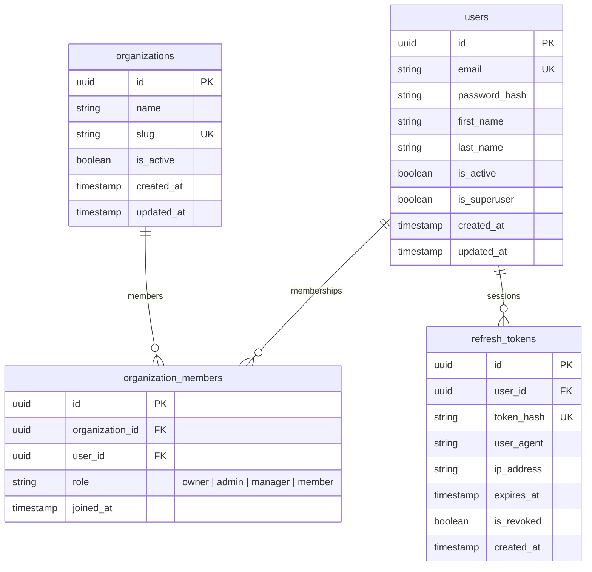

# Спринт 1: Аутентификация, Мультитенантность (Организации) и RBAC

## 1. Архитектурное видение и цели спринта
Цель Спринта 1 — реализовать защищенное, отказоустойчивое и масштабируемое ядро системы авторизации и изоляции данных для B2B SaaS CRM.

Ключевые требования:
1. **Мультитенантность (Multi-Tenancy)**:
   - Модель: **Shared Database, Row-Level Isolation**.
   - Все бизнес-сущности привязаны к `organization_id`.
   - Доступ к данным строго изолирован: пользователь видит только те организации, членом которых он является.
2. **Модель членства (Many-to-Many)**:
   - Пользователь (`User`) может состоять в нескольких организациях (`Organization`) с разными ролями в каждой (`OrganizationMember`).
3. **Ролевой доступ (RBAC)**:
   - Роли: `owner` (Владелец), `admin` (Администратор), `manager` (Менеджер), `member` (Сотрудник).
4. **Безопасная гибридная аутентификация**:
   - Пароли: хеширование по стандарту **Argon2id** (RFC 9106).
   - **Access Token**: Stateless JWT (15 минут), передается в заголовке `Authorization: Bearer <token>`, хранится только в памяти клиента (Pinia Store).
   - **Refresh Token**: Криптографически стойкий непрозрачный токен (хранится в базе/Redis), передается через **HttpOnly, Secure, SameSite=Lax/Strict Cookie** (защита от XSS).
   - **Token Rotation & Replay Attack Detection**: При обновлении сессии старый refresh-токен аннулируется. Повторное использование старого токена приводит к мгновенной инвалидации всего сессионного семейства.

---

## 2. Схема базы данных (ER Diagram)

---

## 3. Таблицы и ограничения целостности (Data Integrity)

1. **`users`**:
   - `id`: UUIDv4 (PrimaryKey, `gen_random_uuid()`).
   - `email`: VARCHAR(255), UNIQUE, NOT NULL, Lowercase.
   - `password_hash`: VARCHAR(255), NOT NULL (Argon2id).
   - `first_name`, `last_name`: VARCHAR(100), NULLABLE.
   - `is_active`: BOOLEAN, DEFAULT true (для мягкой блокировки учетной записи).
   - `is_superuser`: BOOLEAN, DEFAULT false (системный суперадмин платформы).
   - `created_at`, `updated_at`: TIMESTAMPTZ, NOT NULL.

2. **`organizations`**:
   - `id`: UUIDv4 (PrimaryKey).
   - `name`: VARCHAR(255), NOT NULL.
   - `slug`: VARCHAR(100), UNIQUE, NOT NULL (человекопонятный идентификатор тенанта в URL/домене, например `acme-corp`).
   - `is_active`: BOOLEAN, DEFAULT true.
   - `created_at`, `updated_at`: TIMESTAMPTZ, NOT NULL.

3. **`organization_members`**:
   - `id`: UUIDv4 (PrimaryKey).
   - `organization_id`: UUID, FK -> `organizations.id` ON DELETE CASCADE.
   - `user_id`: UUID, FK -> `users.id` ON DELETE CASCADE.
   - `role`: VARCHAR(32), NOT NULL. CHECK (`role IN ('owner', 'admin', 'manager', 'member')`).
   - `joined_at`: TIMESTAMPTZ, DEFAULT NOW().
   - **Индекс уникальности**: `UNIQUE (organization_id, user_id)` — пользователь не может быть добавлен в одну организацию дважды.

4. **`refresh_tokens`**:
   - `id`: UUIDv4 (PrimaryKey).
   - `user_id`: UUID, FK -> `users.id` ON DELETE CASCADE.
   - `token_hash`: VARCHAR(255), UNIQUE, NOT NULL (хешированный токен или SHA-256 отпечаток).
   - `user_agent`: TEXT, NULLABLE (для отображения активных сессий/устройств).
   - `ip_address`: VARCHAR(45), NULLABLE (IPv4/IPv6).
   - `expires_at`: TIMESTAMPTZ, NOT NULL.
   - `is_revoked`: BOOLEAN, DEFAULT false.
   - `created_at`: TIMESTAMPTZ, DEFAULT NOW().

---

## 4. Контракты API (REST Endpoints)

| Метод | URL | Описание | Доступ |
| :--- | :--- | :--- | :--- |
| `POST` | `/api/v1/auth/register` | Регистрация пользователя + создание первой организации (`owner`) | Публичный |
| `POST` | `/api/v1/auth/login` | Вход по email/паролю, установка HttpOnly refresh cookie | Публичный |
| `POST` | `/api/v1/auth/refresh` | Ротация токенов (чтение куки, выпуск новой пары) | Публичный (по куке) |
| `POST` | `/api/v1/auth/logout` | Отзыв текущей сессии (инвалидация refresh токена, удаление куки) | Авторизован |
| `GET`  | `/api/v1/auth/me` | Данные текущего пользователя и список его организаций | Авторизован |
| `GET`  | `/api/v1/organizations` | Список организаций, доступных пользователю | Авторизован |
| `POST` | `/api/v1/organizations` | Создание новой организации пользователем | Авторизован |
| `GET`  | `/api/v1/organizations/{id}/members` | Список участников организации | Член организации (`member`+) |
| `POST` | `/api/v1/organizations/{id}/members` | Добавление участника | Администратор (`admin` / `owner`) |
